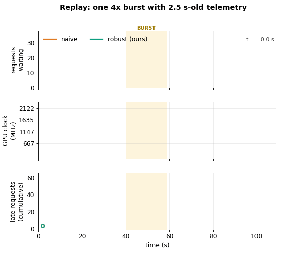
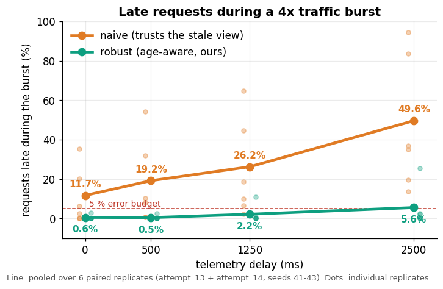
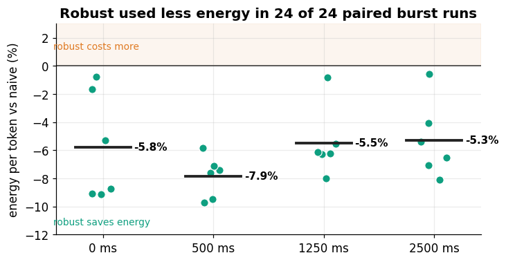
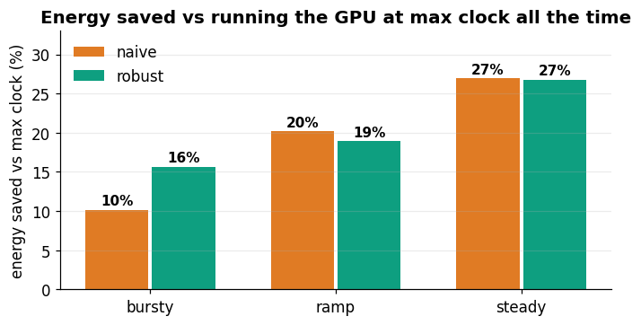
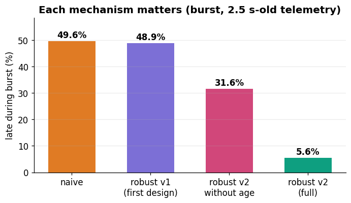

# AMS 560 -- Robust GPU Energy Control for Bursty LLM Inference under Stale Telemetry

**A Delay- and SLO-Error-Budget-Aware DVFS Approach**
AMS 560 * Big Data Systems, Algorithms and Networks * Stony Brook University

---

## Research Question

> Can a delay-aware GPU frequency controller reduce LLM inference energy
> while maintaining a rolling latency SLO error budget under bursty workloads
> and stale telemetry?

Prior work on GPU DVFS for LLM inference assumes timely observations.
This project studies a different failure mode: what happens when telemetry
is delayed or stale at the exact moment a workload burst arrives?

---

## Results at a Glance

> **Telling the controller how old its data is turns a failing GPU power
> manager into one that is both safer and cheaper.**
> On a real RTX 5060 serving an LLM, our age-aware controller cut late
> requests during traffic bursts by **up to 98 %** and used **6 % less
> energy** than the reactive baseline, in **every one** of 24 paired burst runs.

<p align="center">
  
</p>

*One traffic burst (4x the normal load for 20 s) with telemetry that is 2.5 s
old. The **naive** controller (orange) believes the stale view, so it reacts
late, lets the queue pile up, and **53 requests miss the 5 s SLO**. Then it
stays at the top clock until the end of the run, because its latency window
still remembers the burst. The **robust** controller (green) plans over the
age of its data, raises the clock earlier, **misses nothing**, and steps back
down to 667 MHz once the queue is empty. (Representative run: attempt_13,
seed 41; the numbers below are pooled over all runs.)*

### 1. Stale telemetry breaks the baseline; our controller holds the line

<p align="center"></p>

| Telemetry delay | Late during burst: naive | Late during burst: **robust** | Reduction |
|---|---|---|---|
| 0 ms | 11.7 % | **0.6 %** | **-95 %** |
| 0.5 s | 19.2 % | **0.5 %** | **-98 %** |
| 1.25 s | 26.2 % | **2.2 %** | **-92 %** |
| 2.5 s | 49.6 % | **5.6 %** | **-89 %** |

As the telemetry gets older, the reactive controller misses more and more of
the burst: half of all burst requests are late at 2.5 s. The age-aware
controller stays near the 5 % error budget **at every delay**. It had fewer
late requests than naive in 22 of 24 paired runs and **never more**
(Wilcoxon p = 4e-5; request-level Fisher p < 1e-25 at every delay).

### 2. Safer *and* cheaper

<p align="center"></p>

Being careful usually costs energy. Here it saves energy: robust used
**6.1 % less energy per token** than naive on bursty traffic, and was cheaper
in **24 of 24** paired runs (sign test p = 1.2e-7). The saving comes from
*calming down on time*: once the burst is over, robust steps down while naive
stays at the top clock. With 2.5 s-old telemetry robust spends ~28 % of the
run at the top clock, against ~55 % for naive.

<p align="center"></p>

Compared with simply running the GPU at its maximum clock, robust saves
**15-17 % on bursty traffic** and **18-27 % on steady and ramp traffic**,
while keeping burst misses close to the 5 % budget.

### 3. Every piece of the design is needed

<p align="center"></p>

Our first robust design (**v1**) behaves just like naive. Adding lag-aware
signals helps (**v2 without age**: 31.6 %), but the big win comes from
**forecasting over the telemetry age**: the full controller is at **5.6 %**,
nearly 6x better than the same controller without age awareness, with half the
clock changes (7.7 vs 15 per run).

### How we know it is real

* **210 GPU runs** on real hardware: two independent sessions (attempt_13,
  attempt_14), each a full 35-condition matrix with **3 paired seeds**, so
  naive and robust always face the *exact same* arrivals.
* Telemetry delay is injected on **every** controller input (queue, rate,
  P95, error-budget burn, power, clock) at 0 / 0.5 / 1.25 / 2.5 s.
* Every run completed, with >= 99.5 % clock tracking and 0 unfinished requests.
* A 20-seed trace-driven simulator agrees in direction, and a simulated fleet
  of 8 GPUs saves **7-14 %** energy on steady and bursty traffic.
* Full tables, p-values and per-replicate results:
  [`CONCLUSIONS_attempt_13_14.md`](CONCLUSIONS_attempt_13_14.md) and the
  *3-seed replication* page of the dashboard (`dashboard/index.html`).

### Scope

The gains are specific to **bursts**, which is what the controller was built
for. On steady traffic both controllers perform the same, and on a slow ramp
with 2.5 s-old telemetry robust spends about 3 % more energy because it plans
for a rise that naive also handles. Results use one burst size (4x); the two
sessions reuse seeds 41-43. Figures are regenerated with
`python docs/make_readme_figures.py`.

---

## LLM Model

**Primary model:** `Qwen/Qwen2.5-0.5B-Instruct`
- 0.5 billion parameters, instruction-tuned, by Alibaba Qwen team
- Runs in float16 on a single laptop GPU (RTX 5060)
- Small enough for rapid experimentation while generating real CUDA load

**Optional second model** (for external validity): `Qwen/Qwen2.5-1.5B-Instruct`
- Switch via: `python run_experiment.py --model Qwen/Qwen2.5-1.5B-Instruct`
- Keep model fixed within any experiment block so frequency is the controlled variable

---

## Project Structure

```
ams560_gpu_control/
|-- config.py                  # Central experiment configuration
|-- gpu_clock.py               # Clock enumeration & nvidia-smi control
|-- telemetry.py               # NVML background sampler
|-- delay_buffer.py            # Stale-telemetry injection buffer
|-- slo_budget.py              # Rolling SLO error-budget tracker
|-- request_queue.py           # Request dataclass + thread-safe queue
|-- load_generator.py          # Workload generation (steady/ramp/burst)
|-- llm_worker.py              # HuggingFace LLM inference worker thread
|-- metrics.py                 # Energy (trapz), latency stats, CSV logging
|-- controllers/
|   |-- __init__.py            # Factory: get_controller(name, clocks, cfg)
|   |-- base.py                # BaseController + ControllerState dataclass
|   |-- static.py              # Static frequency (high / low baseline)
|   |-- naive_slo.py           # Naive SLO-aware (no age, no budget) baseline
|   \-- robust_delay_budget.py # Proposed robust controller + oracle mode
|-- observation.py             # Delays every controller input, shared phase timeline
|-- capacity_model.py          # Per-clock serving capacity (feasibility floor)
|-- run_experiment.py          # Main CLI experiment runner
|-- run_demo.py                # End-to-end pipeline (sweep -> calibration -> matrix -> figures)
|-- check_gpu_timing.py        # Week-1 GPU checks and delay levels
|-- measure_timing.py          # Characterise real telemetry/clock timing (D3)
|-- bench_clock_sensitivity.py # Does the clock change service time? (model/batch choice)
|-- calibrate_slo.py           # SLO and static-efficient clock from the sweep
|-- oracle_builder.py          # Build oracle lookup table from sweep (D2 -> oracle)
|-- serving_sim.py             # Trace-driven replay of the serving stack
|-- scale_simulator.py         # Simulation grid, 1 and 8 workers (D10)
|-- analyze_results.py         # Post-run analysis and report figures
|-- make_long_prompts.py       # Builds prompts/long_context.jsonl
|-- run_all.ps1                # Wrapper around run_demo.py
|-- setup.ps1                  # One-time environment setup
|-- prompts/
|   |-- long_context.jsonl     # 30 long-context prompts (main workload)
|   \-- prompts.jsonl          # Original short prompts
|-- tests/                     # GPU-free tests (python run_tests.py)
|-- dashboard/                 # Interactive results dashboard (python dashboard/serve.py)
|-- CONCLUSIONS_attempt_12.md  # What the final GPU run shows
\-- results/attempt_12/        # Final GPU run: per-run CSVs, summaries, figures
```

---

## Hardware Requirements

| Requirement | Status |
|-------------|--------|
| NVIDIA GPU with DVFS support | [OK] RTX 5060 Laptop GPU confirmed |
| nvidia-smi clock lock (-lgc) | [OK] Tested and passing |
| CUDA-enabled PyTorch | Required |
| Administrator terminal (Windows) | Required for clock control |

---

## Quick Start

### 1. Environment Setup

Run from an **Administrator PowerShell**:

```powershell
.\setup.ps1
```

Checks the GPU, installs Python dependencies, verifies clock locking,
and runs controller unit tests.

### 2. End-to-end hardware run (Administrator PowerShell)

```powershell
python run_demo.py --quick      # 1 seed, sharp_burst only (~1 h) -- run this first
python run_demo.py --seeds 42   # 1 seed, all workloads (~2 h)
python run_demo.py --primary-only   # proposal run: 24 primary conditions x 3 paired seeds (~3.5-4 h)
python run_demo.py              # 3 paired seeds, all blocks (~4.5-5 h)
```

Pipeline: GPU timing check -> fixed-clock sweep (every verified clock, sharp
burst) -> `calibrate_slo.py` (SLO = 1.5x worst P95 at the top clock, 5% budget;
stops if the clock barely changes latency) -> oracle table -> controller
matrix (run order shuffled per seed) -> simulation -> figures. `.\run_all.ps1`
is a thin wrapper (`-QuickTest`, `-Demo`). Reuse a finished sweep with
`--sweep-from results\attempt_N`. Run several attempts back to back with
`python run_demo.py --repeat-1seed 1 --repeat-3seed 1 --skip-gpu-check`.

What the controller sees: every input (NVML sample AND queue length, P95,
budget burn, arrival stats) is delayed by `--delay-ms`; see `observation.py`.
Delay levels `[0, 500, 1250, 2500]` ms come from the measured NVML refresh
(~500 ms) and clock/power settling (~1.25 s) in `results/gpu_check/`.

### 5. Individual Runs

```powershell
# Robust controller, 500 ms delay, sharp burst
python run_experiment.py --controller robust --delay-ms 500 --workload sharp_burst

# Naive SLO controller, 0 delay, steady workload
python run_experiment.py --controller naive_slo --delay-ms 0 --workload steady

# Fixed-frequency sweep (Deliverable D2)
python run_experiment.py --sweep-clocks

# Ablation: remove telemetry-age term
python run_experiment.py --controller robust --delay-ms 500 --no-age

# Ablation: remove error-budget term
python run_experiment.py --controller robust --delay-ms 500 --no-budget
```

### 6. Timing Characterisation (Deliverable D3)

```powershell
python measure_timing.py
```

### 7. Scale-Out Simulation (Deliverable D10)

```powershell
python scale_simulator.py --results-dir results/attempt_12 --slo-target 5.0 --base-rate 1.8 --n-workers 1 8 --seeds 20
```

Trace-driven (`serving_sim.py`): measured batch times and per-clock power,
every controller input delayed, 20 paired seeds. Writes `sim_runs.csv` and
`sim_summary.csv` (with robust - naive paired differences).

### 8. Analysis and Figures

```powershell
python analyze_results.py --results-dir results/attempt_12 --slo-target 5.0
```

### 9. Results Dashboard

Double-click `dashboard/index.html` (works offline, no server needed), or:

```powershell
python dashboard/serve.py                 # opens http://localhost:8560/dashboard/
python dashboard/serve.py --rebuild       # re-pack the showcase seed first
```

Interactive pages: overview and conclusions, naive vs robust per condition,
a second-by-second run explorer (true vs delayed signals, clock, power,
per-request latency), ablation, testbed characterisation, simulation, report
figures, a 3-seed replication page, and a team & code guide. Needs only
Python; Plotly is vendored in `dashboard/vendor/`.

The single-run pages (overview, results, run explorer, ablation, testbed,
figures) show one showcase replicate, **attempt_13 seed 41**, chosen because it
shows the typical pattern cleanly; every such page says so. The replication
page uses all replicates and carries the statistics. To rebuild:

```powershell
python dashboard/build_data.py --attempt results/attempt_13 --seed 41
python dashboard/build_replication.py --attempts attempt_13 attempt_14 attempt_15
```

`index.html?attempt=attempt_12` still opens the older single-seed run.

### Final results

Headline results with figures: [Results at a Glance](#results-at-a-glance).
Details: [`CONCLUSIONS_attempt_13_14.md`](CONCLUSIONS_attempt_13_14.md)
(3-seed repeats, 210 runs) and
[`CONCLUSIONS_attempt_12.md`](CONCLUSIONS_attempt_12.md) (first single-seed run).

---

## Controllers

| Name | Description |
|------|-------------|
| default | No clock locking -- NVIDIA driver manages frequency |
| static_high | Locked to highest supported clock |
| static_low | Locked to lowest feasible clock |
| naive_slo | Adapts to P95 latency + queue from delayed telemetry; ignores age/budget |
| robust | Uses telemetry age AND error-budget burn rate as explicit risk signals |
| oracle | Fresh-telemetry upper bound using pre-measured frequency lookup table |

### Robust Controller Risk Score

```
risk = 0.30 * q_norm + 0.35 * age_norm + 0.20 * burn_norm + 0.15 * cv_norm

q_norm    = min(queue_len / 10, 1)
age_norm  = min(telemetry_age_ms / 5000, 1)   <- KEY: staleness signal (largest weight)
burn_norm = min(error_budget_burn / 3, 1)      <- KEY: long-horizon reliability
cv_norm   = min(arrival_cv / 2, 1)
```

Priority rules:
1. Emergency  (P95 > SLO OR burn > 2.0) -> up-clock by +2 (bypasses dwell)
2. High risk  (risk > 0.65)             -> up-clock by +1
3. Safe       (risk < 0.30 AND P95 < 0.70 * (1 - 0.5 * age_norm) * SLO) -> down-clock by -1,
              but only once the last clock change can be visible in the telemetry:
              time since change >= telemetry age + 0.7 s clock settling + one batch time
4. Hold       otherwise

### Capacity floor (all dynamic controllers)

`capacity_model.py` fits full-batch service time `t(f) = A + B/f` to the
clock-sensitivity benchmark (within 2 % at 180/1147/2122 MHz) and gives each clock a
capacity `batch / t(f)`. `naive_slo`, `robust` and the robust ablations never run a
clock whose capacity is below 1.25 x the (delayed) observed arrival rate. Static
controllers have no floor.

### Changes after attempt_6

attempt_6 (1 seed, 24 runs) showed three problems, fixed before attempt_7:

1. **Ramp starved.** The generator redrew the arrival gap on every rate change; on a
   ramp the rate changes at every 0.25 s check, so runs got ~5 requests. It now redraws
   only on a phase change. The ramp also went down (fixed 1.2 req/s end vs 2.35 base);
   it now ends at 3 x the base rate.
2. **Start-up trap.** With an empty queue and a lagging P95, every dynamic controller
   stepped down to 180 MHz (0.9 req/s capacity vs 2.35 arriving) and noticed 25-30 s
   later; most misses came from that, not the burst. Fixed by the capacity floor.
3. **Robust frozen by its guard.** The 300 ms hard guard blocked every down-step at the
   injected delays (all >= 500 ms), so robust just stayed at its start clock. Replaced by
   the delay-aware wait and age-scaled headroom above; the guard is kept only for the
   midterm simulation (`experiments/stale_delay_sweep.py`).

### Changes after attempt_7

attempt_7 fixed steady and ramp (0 % misses, ~480 ramp requests), but on sharp_burst
both controllers missed 19-36 %: in the runs a full batch at 2122 MHz took 2.6-2.9 s
(~5.9 req/s) against 2.0 s in the isolated benchmark, so the burst (~7.4 req/s
delivered) overloaded every controller, and one run that happened to get 2.0 s batches
was the only 0 % result. Fixes:

1. **Load from the real stack.** Phase 1c overloads the top clock inside the runner
   (all threads running) and measures full-batch throughput; the base rate is set so
   the burst peak is 0.9 x that capacity (`probe.json`).
2. **Capacity floor from in-stack data.** `capacity.json` now uses median full-batch
   times from the sweep and the probe (A + B/f only fills unmeasured clocks).
3. **Scheduled arrivals.** The load generator draws a non-homogeneous Poisson schedule
   (thinning) from the seed and enqueues overdue requests at once, stamped with their
   scheduled time; GIL contention no longer drops ~20 % of burst arrivals.
4. **Same-session reference.** `--primary-only` adds `static_high` (2122 MHz) per
   workload, 27 runs per seed.

Before a run: plug in AC, set Windows power mode to Best performance, close heavy
apps. Decode is CPU-bound, so CPU state changes batch time by up to ~35 %.

### Changes after attempt_8-11

attempt_8-11 (216 runs, 4 independent sessions) were clean and repeatable (J/token
within ~2 %), and showed stale telemetry raising burst misses from ~1 % to ~12 %.
But robust and naive_slo were indistinguishable (32 paired runs per workload,
p > 0.1 for energy, misses and P95): in 25 of 32 burst pairs their clock traces were
>95 % identical, because every up-step came from the shared capacity floor reading a
10 s arrival rate that is itself `age` old, and after the burst both held 2122 MHz
to the end because the 60 s P95 window stayed above the SLO. Fixes:

1. **Robust v2: age-compensated forecast.** The observed rate and queue are rolled
   forward over telemetry age + settling when the queue is surging; robust steps up
   to the clock that covers that demand (top clock on a large stale surge) before
   the 10 s rate catches up. `robust_no_age` uses settling only.
2. **Robust v2: lag-aware P95 / burn.** With no backlog over the blind window, the
   60 s P95 and burn are treated as history: no emergency up-step, and a
   capacity-backed down-step when the next clock covers 1.35 x the recent peak.
3. **Fixed SLO** (`--slo-target`, default 5.0 s) instead of per-attempt calibration
   (4.0-6.0 s in attempt_8-11), so attempts can be pooled.
4. **Ablations in `--primary-only`:** `robust_v1` (the attempt_8-11 controller) and
   `robust_no_age` on sharp_burst x 4 delays; 35 runs per seed (`--no-ablation`: 27).
5. **Simulator rebuilt** (`serving_sim.py`, `scale_simulator.py`): batched workers with
   batch times measured in attempt_10/11, measured idle/busy power, every controller
   input delayed. The old one gave the same numbers for every controller and delay.
   At SLO 5 s it reproduces naive's burst misses (12.7 % at 2500 ms vs 12 % on the GPU).

Simulated, 1 GPU, SLO 5 s, 20 paired seeds (robust - naive):

| Workload | 0 ms | 500 ms | 1250 ms | 2500 ms |
|---|---|---|---|---|
| sharp_burst J/token | -8.4 % | -8.1 % | -6.3 % | -4.2 % |
| sharp_burst misses | 4.3 -> 2.4 % | 4.7 -> 1.6 % | 8.1 -> 3.4 % | 12.7 -> 5.7 % |
| steady J/token | +0.2 % | +0.5 % | +0.9 % | +2.0 % |
| ramp J/token | +0.1 % | +1.1 % | +2.5 % | +3.5 % |

Burst misses at 2500 ms by ablation: naive 12.7 %, robust_v1 11.7 %, robust_no_age
9.6 %, robust 5.7 %. With 8 workers sharing one clock policy, robust uses 2-14 % less
energy than naive at the same burst miss rate (within 0.8 pp).
Steady and ramp misses are ~0 for both. The extra energy on steady/ramp at large
delays is the price of provisioning ahead of a queue surge that stale telemetry
cannot confirm. These are simulator results; the GPU runs decide.

---

## Experiment Matrix (per seed)

| Block | Controllers | Delays (ms) | Workloads |
|-------|-------------|-------------|-----------|
| Primary | naive_slo, robust | 0, 500, 1250, 2500 | steady, ramp, sharp_burst |
| Reference | static_high | 0 | all three |
| Ablation | robust_v1, robust_no_age | 0, 500, 1250, 2500 | sharp_burst |
| Reference | static_efficient (from calibration) | 0 | all three |
| Reference | oracle (fresh telemetry) | 0 | sharp_burst |

Each run: 10 s warm-up + 110 s measurement (40 s steady, 20 s burst at 4x,
50 s recovery). Unfinished requests count as misses.

**Workload: long-context requests** (`prompts/long_context.jsonl`, built by
`make_long_prompts.py`): ~0.75-1.3k-token documents (service logs, sales
tables, meeting notes) with 16-32-token answers. On this laptop every CUDA
kernel launch costs ~49 us of CPU time, so decode runs at ~57 ms/step at *any*
GPU clock (GPU 12-18 % busy); short-prompt chat requests give DVFS nothing to
trade. Prefill of long prompts is GPU-bound (77-92 % busy), so service time
follows the clock. `bench_clock_sensitivity.py` (phase 1b of `run_demo.py`)
locks 180 / 1147 / 2122 MHz, picks the batch size with the largest
slow/fast ratio (>= 1.5x required), and sets the base rate to 30 % of the
top-clock capacity.

---

## Deliverables Checklist

| ID | Deliverable | Script |
|----|------------|--------|
| D1 | Experiment harness + guaranteed clock reset | run_experiment.py |
| D2 | Fixed-frequency characterisation | --sweep-clocks flag |
| D3 | Real timing characterisation | measure_timing.py |
| D4 | Workload suite (steady/ramp/burst) | load_generator.py |
| D5 | Delay injector (0-1000 ms + jitter) | delay_buffer.py |
| D6 | Baselines + oracle | controllers/ |
| D7 | Robust controller with acceptance tests | controllers/robust_delay_budget.py |
| D8 | Failure-boundary analysis | analyze_results.py Fig 7 |
| D9 | Ablation + non-redundancy | --no-age / --no-budget flags |
| D10 | Scale-out simulation + reproducibility | scale_simulator.py |

---

## Output Logs (in results/)

| File | Contents |
|------|----------|
| {run_id}_telemetry.csv | t, power_w, graphics_mhz, sm_mhz, util_pct, temp_c, phase |
| {run_id}_requests.csv | request_id, arrival_t, finish_t, latency_s, slo_miss, ... |
| {run_id}_control.csv | t, selected_mhz, telemetry_age_ms, queue_len, burn_rate, ... |
| run_summary.csv | One row per run: j_per_token, p95, miss_rate, recovery_s, ... |
| sweep_summary.csv | Fixed-clock sweep energy/latency characterisation |
| oracle_table.csv | Per-bucket minimum feasible clocks |
| timing_characterisation.json | NVML update rates, command latencies |

---

## Figures Produced

1. Telemetry delay vs J/token (per controller)
2. Telemetry delay vs SLO miss rate (with budget line)
3. Burst time-series (queue, clock, age, P95)
4. Cumulative energy over time
5. Error-budget burn rate over time
6. Energy gap from oracle
7. Failure boundary heatmap (delay x burst intensity)
8. Ablation comparison

---

## References

1. throttLL'eM (2024): https://arxiv.org/abs/2408.05235
2. GreenLLM (2025): https://arxiv.org/abs/2508.16449
3. EcoInfer (2026): https://www.mdpi.com/2079-9292/15/10/2139
4. BEAM MLSys (2026): https://proceedings.mlsys.org/paper_files/paper/2026/hash/eb3c42ddfa16d8421fdba13528107cc1-Abstract-Conference.html
5. KAIROS (2026): https://arxiv.org/abs/2604.16682
6. Google SRE Book: https://sre.google/sre-book/service-level-objectives/
7. NVIDIA nvidia-smi: https://docs.nvidia.com/deploy/nvidia-smi/index.html
